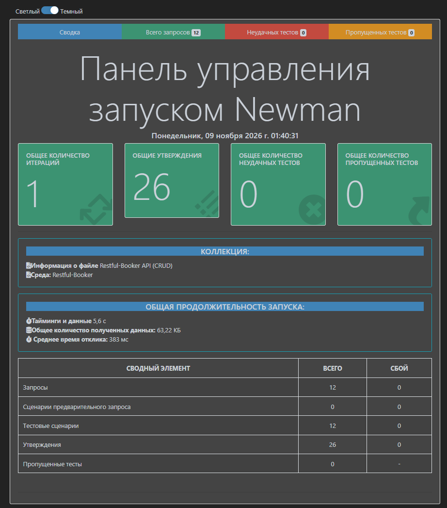

# API-тестирование: Restful-Booker (Postman + Newman)

Коллекция Postman для тестирования учебного REST API бронирования отелей [Restful-Booker](https://restful-booker.herokuapp.com) (документация: [apidoc](https://restful-booker.herokuapp.com/apidoc/index.html)). Проверяется полный цикл CRUD, авторизация по токену и негативные сценарии. Прогон выполняется из командной строки через Newman с HTML-отчётом.

## Что проверяется

12 запросов, 26 проверок.

**01 Позитивные сценарии (CRUD)**

| Запрос | Что проверяется |
|---|---|
| GET Список бронирований | код 200, непустой массив, у каждой записи числовой `bookingid` |
| POST Получение токена | код 200, токен получен и сохранён в переменную |
| POST Создание брони | код 200, присвоен `bookingid`, данные совпадают с отправленными |
| GET Бронь по id | код 200, `Content-Type`, данные совпадают, структура ответа по JSON-схеме |
| PUT Полное обновление брони | код 200, все поля обновлены |
| PATCH Частичное обновление брони | код 200, изменились только переданные поля, остальные сохранены |
| DELETE Удаление брони | код 201 и тело `Created` |
| GET Бронь после удаления | код 404: бронь действительно удалена |

**02 Негативные сценарии**

| Запрос | Ожидаемое поведение |
|---|---|
| POST Неверный пароль | токен не выдан, в ответе `Bad credentials` |
| PUT Без токена | 403 Forbidden |
| GET Несуществующая бронь | 404 Not Found |
| POST Неполное тело | запрос отклонён (см. наблюдения) |

Цепочка CRUD работает на собственных данных: бронь создаётся в начале и удаляется в конце, `bookingId` и токен передаются между запросами через переменные окружения.

## Наблюдения по поведению API

- Неверный логин или пароль: сервис отвечает кодом **200** с телом `{"reason":"Bad credentials"}`. Ожидаемый код для такого случая 401.
- Удаление брони возвращает **201 Created** и текст `Created`, а не 200 или 204.
- Запрос создания брони с неполным телом (только `firstname`) приводит к **500 Internal Server Error**. Правильный ответ на невалидные данные 400.

В тестах эти особенности зафиксированы как фактическое поведение сервиса.

## Структура

```
├── collection.json        # коллекция Postman (формат v2.1)
├── environment.json       # окружение: baseUrl и тестовые данные для входа
├── newman-report.png      # скриншот HTML-отчёта Newman
└── README.md
```

## Как запустить

Нужен Node.js.

```bash
npm install -g newman newman-reporter-htmlextra
newman run collection.json -e environment.json -r "cli,htmlextra" --reporter-htmlextra-export report.html
```

Кавычки вокруг `cli,htmlextra` нужны в PowerShell. После прогона отчёт лежит в `report.html`.

Либо импортируйте `collection.json` и `environment.json` в Postman, выберите окружение и запустите коллекцию через Runner.

## Результат прогона



## Примечания

- Сервис общедоступный, данные в нём сбрасываются примерно раз в 10 минут. Тесты это учитывают, так как создают данные сами.
- Логин и пароль в `environment.json` общедоступные и приведены в документации сервиса.
